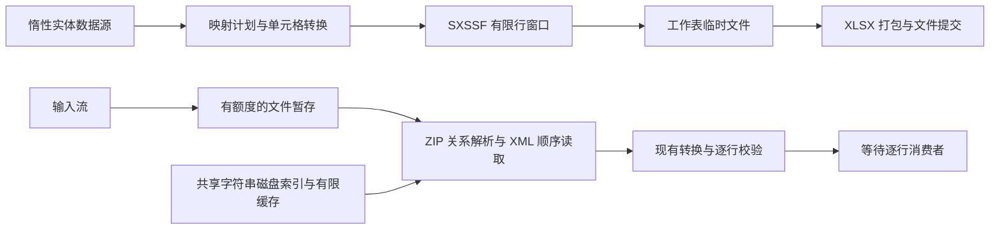

# Excel 低内存导入导出实施方案

- Task ID：`BO-EXCEL-LOW-MEMORY-20261027`
- 日期：2026-10-27
- 状态：`APPROVED`；用户已明确授权实施，执行状态见 execution.md。
- 需求：基于 `SXSSFWorkbook` 分析低内存导入、导出的可行实现及落地步骤。
- 代码依据：当前工作区，HEAD `84958c1cc5eec5afbae51d76b0d07b4ab133b748`。工作区包含此前任务的修改，本方案不将其归入本任务，也不要求清理或回退。
- 约束：遵循根目录 `AGENTS.md`、用户级规则、`GOAL_RULES.md` 和 `create-plan` 技能；保留现有 API 和默认行为，不自动提交、推送或发布。

## 1. 推荐方案与技术边界

### 本次批准的执行参数（优先于下文早期候选描述）

- 验收固定为 10 列、1 万/10 万行、重复/高唯一字符串两类样本；50 万/100 万行不属于本次门槛。记录峰值，不设固定 MB 性能门槛。
- 默认窗口 100 行，压缩临时 XML；字符串存储与缓存共用 8 MiB 预算；单格 32767 字符、单行 262144 字符、窗口 2097152 字符。
- 默认 100 列；Sheet/样式/字体上限 32/4096/256；唯一值 100000 项及 8388608 字符；1000 个错误停止，摘要保留 100 个错误样本；库自有临时文件每次调用 512 MiB。其余输入/ZIP/XML 额度沿用现有有限默认。
- 行回调 RowIndex 为零基；既有 ExcelImportError 行列号保持一基。消费者停止追加 ConsumerStopped；调用方流保持打开。
- 清理先 SXSSFWorkbook.Dispose，再关闭 XssfWorkbook；失败时逐 SheetDataWriter 尽力释放，保留主异常并记录清理失败。
- 本节来自用户明确的实施指令，覆盖文中“候选默认值”“规模待定”等早期描述。新增 API、资源配置及验证范围已获实施授权，不重复请求批准。

建议采用 **SXSSF 顺序导出 + XLSX XML 顺序导入 + 现有映射/转换/校验复用**。

`SXSSFWorkbook` 是写入工具，不能承担已有 Excel 文件的低内存读取。导出使用仓库已锁定的 NPOI 2.7.4；导入在 NPOI Provider 包内使用 `ZipArchive(Read)`、`XmlReader` 和磁盘共享字符串索引，不为此新增 Open XML SDK 依赖。

第一版提供独立的 `IExcelStreamingExporter`、`IExcelStreamingImporter`，调用方显式选择。现有 `IExcelExporter`、`IExcelImporter` 保持原有完整工作簿能力。新模式遇到不支持的配置时给出明确错误，不自动回退为 DOM。

“低内存”的目标是：**库内不保留全部数据行、全部输出字节、全部导入实体或全部共享字符串；在行宽、样式、缓存和校验额度确定时，主要驻留数据不随总行数线性增长。** 这不等于零内存、零临时文件，也不等于整个进程有固定的内存上限。调用方的数据源、消费者缓存及自定义转换器仍由调用方控制。



## 2. 当前实现与完成情况

以下为真实调用链核验结果，不以类型或接口存在推断功能完成。

| 能力 | 当前状态 | 证据及影响 |
|---|---|---|
| Excel Fluent 配置、固定/动态列、映射计划 | 已实现，可复用 | `Abstractions/.../Exports/ExcelExport.cs`、`Imports/ExcelImport.cs`、`Providers/IExcelMappingPlan.cs`；Core 的映射计划工厂负责合并和编译 |
| 惰性导出数据入口 | 已实现，但整体导出仍保留工作簿 | `ExcelSheetExportRequest.Data` 是 `IEnumerable`；`NpoiExportSheetWriter` 逐项消费，但创建的行仍属于 DOM 工作簿 |
| 导出样式、列宽、合并、图表 | DOM 路径已实现，不能原样复用 | `NpoiExportSheetWriter.Write<T>` 写完所有数据后调用样式、列宽、合并与图表处理；已刷出的 SXSSF 行无法重新访问 |
| 导入读取与结果交付 | 已实现，但整体仍占内存 | `NpoiExcelImporter` 暂存输入到 `MemoryStream` 后 `WorkbookFactory.Create`；结果保留 Workbook 模型集合和 `SourceRows` |
| 逐行转换与校验 | 部分可复用 | `NpoiImportRowMaterializer` 依赖 `IRow/ICell`；`ExcelCellValue`、映射绑定、转换器和校验规则已提供中立契约 |
| 文件原子提交、异步暂存 | 已实现基础设施 | `IFileExportCommitter`、`NpoiAsyncStaging` 提供提交、Memory/TempFile/Hybrid 暂存；新模式应显式使用文件暂存 |
| XLSX ZIP/XML 预检 | 已实现基础设施 | `NpoiXlsxZipPreflight` 限制输入大小、条目、解压大小、压缩比和 XML；当前扫描为同步，不可直接宣称为全异步读取 |
| SXSSF 低内存导出服务 | 未实现 | 当前默认导出调用链未建立 SXSSF 窗口写入路径 |
| 不累计实体的 XLSX 导入服务 | 未实现 | 当前没有以逐行消费者作为终端的公开 Excel 导入入口 |
| 新模式资源、取消、兼容性证据 | 未验证 | 本轮仅只读核验源码、配置和 NPOI 程序集，没有运行新模式测试或 Benchmark |

现有完整工作簿功能不是空壳；缺少的是两条新的数据处理路径及其资源契约。低内存导入、导出目前均不能标为“已完成”，也没有可报告的实测节省比例。

路径前缀说明：表中的 `Abstractions/...` 指 `src/Bing.Offices.Abstractions/Bing/Offices/`；Core 与 NPOI 的同名目录分别位于 `src/Bing.Offices.Core/Bing/Offices/`、`src/Bing.Offices.Npoi/Bing/Offices/`。

### 2.1 已核实的 NPOI 2.7.4 行为

依据 `version.dev.props`、恢复后的 NuGet assets、本地 `NPOI.OOXML.dll` 的反射元数据/IL 及 XML 文档：

1. `SXSSFWorkbook` 默认行窗口为 100；窗口外的行写入每个 Sheet 的临时文件。`FlushRows` 可以主动释放窗口。
2. `Write(Stream, bool)` 先刷新工作表，创建中间模板 `.xlsx` 文件，再经 ZIP 输出流注入工作表数据。这条方法链没有把整份最终输出放入 `MemoryStream`；仍须实测基础包、样式及最终打包阶段的峰值。
3. `CompressTempFiles` 为工作簿实例设置，只影响之后创建的 Sheet。压缩用 CPU 时间换磁盘空间，必须在建 Sheet 前设置。
4. 默认使用 inline strings；启用共享字符串后，所有唯一字符串会在内存中保留。合并区域、批注、样式和字体也不受行窗口释放控制。
5. `Dispose()` 负责删除 Sheet 临时文件，返回所有删除操作的聚合结果；部分删除异常会被转为 `false`。`Close()` 不能替代删除检查。
6. 该版本的临时文件位于 `Path.GetTempPath()/poifiles`。没有可用的逐实例目录设置器；`SXSSFWorkbook.CreateSheetDataWriter()` 非虚，最终 `Write` 无可替换的临时文件工厂。不能靠简单继承注入完整的逐任务临时目录/配额。
7. 模板包装只能追加：模板先作为 `XSSFWorkbook` 加载；既有行不进入 SXSSF 窗口，不能覆盖旧行。首版不开放模板路径。
8. 自动列宽需要在写入前启用列跟踪，并有额外计算成本。首版使用显式列宽，不复用 DOM 写完后遍历所有行的方案。
9. 本地 2.7.4 没有发现可直接使用的 `XSSFReader`/`XSSFSheetXMLHandler`。不能把 Java POI 或 NPOI 新版示例当作当前依赖已有的导入能力。

## 3. 首版范围

| 功能 | 低内存导出 | 低内存导入 |
|---|---|---|
| 文件格式 | 新建普通 `.xlsx` | 普通、未加密 `.xlsx`，首版限定 Transitional OOXML |
| 多工作表文件 | 支持顺序写入，结束一个 Sheet 后刷新其窗口 | 支持按名称或索引选择一个 Sheet；一次调用交付一种实体 |
| 映射 | Convention、Attribute、Profile、MappingDocument、请求覆盖 | 复用相同映射来源与既有优先级 |
| 固定列、动态列 | 支持预先声明、数量受限的列，不扫描全量数据发现列 | 支持已有动态列映射语义，表头扫描受列数和文本额度限制 |
| 标量值 | 文本、数值、布尔、日期、空值及既有转换器 | 同左，另支持错误单元格的既有错误表达 |
| 公式 | 不提供公式计算；首版不新增公式写入 API | 使用缓存结果；无可用缓存时给出行错误，不现场计算或重建共享公式 |
| 表头、样式、列宽 | 单行表头、有限且可复用的样式、数字格式、换行、显式列宽 | 表头/别名/空白策略、有限样式表和日期格式识别 |
| 校验 | 保持导出现有转换/错误语义 | 必填、范围、格式、自定义逐行校验；唯一值校验有额度上限 |
| 结果 | 写入调用方流或原子提交到文件 | 逐行回调 + 小型统计结果，不返回全量 `List<T>` 或 `SourceRows` |
| 同步与异步 | 同步序列化；异步入口对最终外部流使用真实异步 IO | 同步入口及真正异步的文件/条目读取、字符串索引查询、消费者等待 |
| `.xls`、图片、图表、批注、复杂合并、模板填充 | 首版不支持，新入口提前拒绝相关配置 | 首版不提取图片，不做跨 Sheet 导航关系组装或原工作簿错误标注 |

补充边界：

- 输入文件存在图片/图表，不等于标量导入必定失败；未请求的视觉部件不加载，仍执行适用的包级资源检查。请求图片字段等不可满足的功能必须报错。
- 不支持多级合并表头、自动列宽、任意旧行更新、全量排序、跨行公式求值。后续可以增加有界的专用实现，但不列入首版完成条件。
- 多个 Sheet 引用同一个一次性数据源时，库不替调用方缓存或重放。每个 Sheet 的数据源只枚举一次。
- 流式导入首版以单 Sheet 为交付单位；在同一包会话内注册多类型消费者是后续扩展，不假装现有 Workbook 集合模型可以零成本转为流式。
- 第一版不新增 `IAsyncEnumerable<T>` 公共依赖。Abstractions 当前目标为 `netstandard2.0`，使用 BCL 的 `Task` 回调兼容该边界；异步数据源导出适配可另行设计。

## 4. API 与模块设计

以下名称、签名和示例均为拟新增契约，当前代码中尚不存在。实施时先固化成员清单，再编写消费者与快照。

### 4.1 显式低内存服务

| 拟新增成员 | 职责 |
|---|---|
| `IExcelStreamingExporter` | `Export`、`ExportAsync`、`ExportToFile`、`ExportToFileAsync`；复用 `ExcelWorkbookExportRequest`，附加低内存选项 |
| `ExcelStreamingExportOptions` | 行窗口、临时 XML 压缩、列/文本/样式额度、可控输出暂存额度等；不暴露 NPOI 类型 |
| `IExcelStreamingImporter` | 泛型 `Import<T>`、`ImportAsync<T>`，接受单 Sheet 请求、输入流、逐行消费者、选项和取消令牌 |
| `ExcelStreamingImport` / `ExcelStreamingImportRequest<T>` | 无 Workbook 集合目标的 Fluent 请求构建，明确 Sheet 选择和映射配置 |
| `ExcelStreamingImportOptions` | 有效资源限制、共享字符串内存/磁盘策略、错误与唯一值额度、库自有临时目录 |
| `ExcelImportRow<T>` | 当前行索引、实体（仅合法时可消费）、行错误、有效状态；不携带整表或无限原始文本 |
| `ExcelRowReadDecision` | 消费者返回 `Continue` 或 `Stop`，与异常/取消区分 |
| `ExcelStreamingImportSummary` | 读取/成功/失败/交付计数、有限诊断样本、总错误数、`IsSuccess`、`IsComplete`、`StopReason` |
| `AddBingOfficesNpoiStreaming` | 显式注册新服务并复用 Core 依赖；`TryAdd` 尊重自定义实现和注册顺序 |

异步消费者采用 `Func<ExcelImportRow<T>, CancellationToken, Task<ExcelRowReadDecision>>`；同步消费者采用对应同步返回值。异步入口等待本次消费者完成后再前进，默认没有预读队列和并行回调。

调用形态示意：

```csharp
// 拟新增 API 示例；rows 是惰性数据源，不能先把全量数据 ToList。
var exportRequest = ExcelExport.Workbook(workbook =>
    workbook.AddSheet("Orders", rows));

await streamingExporter.ExportToFileAsync(
    exportRequest, outputPath,
    new ExcelStreamingExportOptions { RowWindowSize = 100 }, cancellationToken);

var importRequest = ExcelStreamingImport.Sheet<Order>("Orders");
var summary = await streamingImporter.ImportAsync(
    importRequest, input,
    async (row, token) =>
    {
        if (row.IsValid)
            await SaveOrderAsync(row.Item, token);
        return ExcelRowReadDecision.Continue;
    },
    new ExcelStreamingImportOptions(), cancellationToken);
```

实际应用可在消费者内累计一个有固定行数/字节上限的批次后提交数据库；库等待消费者完成，不替应用开启事务或重试。返回的行对象不得复用可变缓冲区，调用方保留它时不能在下一行被悄悄改写。

### 4.2 复用与必要解耦

1. **请求配置**：现有 `ExcelSheetImportBuilder<T>` 在构建时编译 Workbook 集合目标表达式，不能传一个假集合来复用。提取内部 Sheet 配置快照及校验逻辑，分别由原 Workbook builder、新 streaming builder 使用；保留原公开成员。
2. **导出计划**：复用 `NpoiExportPlanBuilder`、`NpoiExportColumnPlanner` 和中立映射计划。提取必要的标量写入/样式解析逻辑，建立专用顺序写入器，禁止复制整个 DOM writer 再零散修改。
3. **样式**：先合并 Sheet/表头/正文/列样式，再在创建单元格时赋值；按工作簿缓存并设上限。核验 `NpoiStyleCache` 内对 `XSSFWorkbook`、字体/颜色的判断在 SXSSF 下的适配，避免类型转换假设。
4. **导入材料化**：在 NPOI 内部提取有界行值访问接口，以 `ExcelCellValue` 承载标量；DOM 适配器与 XML 行适配器共用列绑定、转换和逐行校验。图片索引、跨 Sheet 关系继续属于原 DOM 路径。
5. **缓存**：数据行、请求执行状态、临时文件、唯一值集合不能进入静态缓存。仅复用不可变计划；若改变缓存键或配置快照，必须补隔离、命中、未命中、重复执行和失败后状态测试。
6. **依赖方向**：Abstractions 只增加 BCL 契约；Core 保持无 NPOI；具体 SXSSF、ZIP/XML、磁盘索引均放 NPOI。实现类及辅助存储默认 `internal`，通过公开接口和 DI 使用，不新增无必要的 SPI。

## 5. 导出执行过程

1. 验证请求、选项、格式及完整映射计划；检查模板、图片、合并、多级表头、自动列宽等不支持的配置。验证不枚举业务数据，不提前截断既有目标文件。
2. 创建 `SXSSFWorkbook`，配置行窗口和临时 XML 压缩；默认 inline strings，不开放无界共享字符串模式。
3. 按 Sheet 顺序创建工作表，写入有限表头，预设列宽。每个实体只读取一次，每个字段转换一次，立即应用最终样式与数字格式。
4. 同时限制窗口行数和驻留文本规模。不能只配置 100 行却接受单行无限长数据；超宽/超长单行应明确拒绝，需要缩小窗口时主动刷新旧行。
5. 一个 Sheet 完成后刷新其全部数据行，再处理下一个 Sheet，避免每个 Sheet 都保留完整窗口。Sheet 数、样式、字体和工作簿元数据也设上限。
6. 在行间、字段转换边界及包装后的可控流 IO 处检查取消。XLSX 的 1,048,576 行/16,384 列包含表头和起始偏移，超限必须在创建非法单元格前失败。
7. 序列化到库自有文件暂存，再复制到外部流；文件路径入口通过 `IFileExportCommitter` 提交。避免在异步路径重新使用默认 Hybrid 或整份输出 `MemoryStream`。
8. 关闭、释放 NPOI 工作簿并检查 Sheet 临时文件删除结果。清理步骤的准确顺序通过 Phase 0 小样本和取消用例固化；主异常必须优先保留。

`ExportAsync` 的 SXSSF 行创建、刷盘及 NPOI ZIP 序列化仍有同步部分。使用异步文件流和 `CopyToAsync` 可以保证外部异步 IO 契约，但不能把整个方法描述为无阻塞异步，也不能使用 `Task.Run` 包装它。

## 6. 导入执行过程

### 6.1 输入与包读取

- 从调用方输入流的当前位置复制到库自有的、有大小限制的临时文件；调用方流保持打开，不承诺恢复其位置。首版统一文件暂存，避免不同流类型具有隐式、难测的内存行为。
- 这样做也避免 .NET 6/8 的 `ZipArchive(Read)` 在不可 Seek 输入上自行整份复制到 `MemoryStream`。
- 解析 Content Types、根关系、Workbook 和 Workbook relationships；按真实关系找到所选 Sheet，不假设索引等于 `sheet1.xml` 文件名。规范化合法相对路径，拒绝越界和外部关系访问。
- 复用并拆分现有预检职责：包元数据检查、实际解压字节计数、XML 安全设置。不要为了“流式”关闭 ZIP 限制，也不要无意增加多次全包 DOM 或 XML 加载。
- 对被解析的 XML 同时控制字符数、深度和实际解压字节；对于未消费部件明确元数据预检边界，不声称已验证其所有内容。禁用 DTD/外部解析。
- XML 读取不采用 `XDocument.Load`、整表 `ReadOuterXml` 或按 `dimension` 一次性分配数组。异步路径设置 `XmlReaderSettings.Async`，使用真实异步底层文件/条目读取。

### 6.2 共享字符串与样式

`sharedStrings.xml` 是大文件导入的主要风险：只流式读取工作表，但将全部字符串读入 `List<string>`，仍会随唯一字符串数量增长。

建议提供内部字符串存储：小表在额度内使用内存，达到阈值后一次性转为临时文件。字符串 UTF-8 数据和定长偏移索引都存磁盘，索引不能继续以全量数组留在内存；按字节预算保留有限缓存。

- 存储按共享字符串编号查找；计入数据文件、索引文件和缓存的额度，溢出或磁盘写入失败都明确结束。
- 合并 `<si>` 下文本/富文本的实际文本，遵守空白保留规则，不混入注音文本。单字符串在拼接期间检查长度，不能先分配巨型字符串再检查。
- 处理 inline string、共享字符串、`str`、数值、布尔、错误、空单元格及缓存公式类型；越界索引、无效样式和无缓存公式给出明确诊断。
- 样式只保留所需的有限数字格式映射；核验内置/自定义格式、1900/1904 日期系统以及既有日期解析语义。不得用简单的“格式包含 d”替代现有日期规则。

### 6.3 逐行转换与交付

1. 按原有表头/数据起始行配置扫描，尊重选列、别名和空白策略；限制表头与动态列规模。
2. 依据单元格坐标补齐选中列的缺失值；稀疏行、不连续行、空行结束策略按契约处理，不因维度声明而遍历海量空行。
3. 使用同一列绑定和转换器构造当前实体，进行逐行校验。唯一值跟踪有数量和文本额度，失败行的跟踪回滚保持现有语义。
4. 对每个被处理的数据行回调一次，包括行校验失败的结果；失败实体不得作为合法数据交付。回调中的行号沿用库现有索引约定，OOXML 的 1 基坐标只在解析边界转换。
5. 等待消费者完成，释放当前行临时数据，再读取下一行。库只累计统计和有限错误样本，不累计实体、源行列表或完整原始值。
6. 正常完成、显式停止、取消、消费者异常均关闭 XML/ZIP/索引/文件句柄并清理库自有文件。

共享字符串可能需要先完成索引构建才能交付第一行；首行延迟需要纳入指标，不能用“逐行回调”暗示无需前置扫描。

## 7. 资源、结果与失败语义

### 7.1 内存和磁盘预算

| 部分 | 控制方法 | 必须说明的边界 |
|---|---|---|
| 导出行 | `RowWindowSize` + 单行/窗口文本额度 + 列数 | 行数上限不是内存字节上限；文本额度是可执行的规模边界，不伪装为精确 GC 堆配额 |
| 导出全局对象 | 限 Sheet、样式、字体、元数据；inline strings | 批注、图片、无界合并不在首版 |
| 输入/输出暂存 | 文件流、字节计数、独立生命周期 | 向 `MemoryStream` 输出时，调用方仍会保存全部结果 |
| 共享字符串 | 有限内存阈值 + 磁盘数据/索引 + 有限缓存 | 高唯一值数据必须触发真实落盘路径 |
| 校验与错误 | 有限唯一值跟踪、错误总量阈值和样本上限 | 不提供无限精确去重或无限错误集合 |
| NPOI 自有临时文件 | 宿主临时盘容量、数据规模限制、清理检查、资源实测 | 2.7.4 无完整逐请求目录/硬配额钩子；库不能承诺所有 NPOI 文件都位于自定义目录 |

导入近似驻留规模为“一行 + 有限表头/格式表 + 字符串缓存 + 有限唯一值状态 + 有限错误样本”；导出近似为“有限行窗口 + 有限样式/字体 + 有限工作簿元数据”。磁盘仍可能随文件规模增长。

候选配置以 NPOI 默认窗口 100 起步，字符串缓存可从 8 MiB 级小样本评估；这些是调优起点，**不是已验证的默认值或性能承诺**。Phase 0 固化各资源选项的有效默认值，Phase 5 记录容量与测量证据。新模式不得继承 `null` 就无限收集错误/唯一值的行为，既有 DOM 默认值则不改变。

已有 `ExcelResourceLimits` 默认包括：输入 128 MiB、单 ZIP 条目 64 MiB、总解压 512 MiB、单 Worksheet 64 MiB、全部 Worksheet 256 MiB、共享字符串 64 MiB。这些限制会影响百万行样本，不能仅增大 `MaxRows` 就声称支持。较大资源档位必须显式配置并验证。

**临时目录决策**：拟新增的 `TempDirectory` 仅控制库自己的输入、输出和字符串索引文件，文档必须列出 NPOI 的系统临时目录。不得在请求期间修改进程 `TEMP/TMP`，不得扫描并删除其他任务的 `poifiles`。若部署要求“每请求所有临时文件必须隔离并有硬配额”，固定 NPOI 2.7.4 的进程内方案无法直接满足，应单独评估宿主进程隔离或 NPOI 上游改造，不偷偷扩大本任务。

### 7.2 结果、停止和异常

- `ExcelStreamingImportSummary.IsSuccess` 定义为无错误且 `IsComplete`；错误样本截断后仍由总错误数判断，不以样本为空误报成功。
- 正常结束及显式配置的范围终点为 `ImportStopReason.None`；存在普通行错误仍可 `IsComplete=true`。
- 消费者返回 `Stop` 为不完整结果，拟在现有枚举末尾追加 `ConsumerStopped`，保留既有数值和旧结果推导逻辑。迁移文档提示枚举增加值。
- 表头结构拒绝、行处理中的资源耗尽、达到错误总量上限分别对应 `InvalidHeader`、`ResourceLimit`、`ErrorLimit`；结果包含有限且明确的诊断。
- “错误样本收集上限”只截断样本，不自动代表停止；“错误总量停止阈值”才结束处理，两个概念不能混用。
- 包损坏/预检失败/格式不支持发生在交付前时，保持明确异常类别；取消抛出 `OperationCanceledException`，消费者异常原样传播，不改写为行校验错误。具体异常类型在契约测试中固定。
- 主操作失败后清理失败应附带诊断并保留主异常；仅清理失败也必须可观察。检查 NPOI `Dispose()` 的 `false` 返回，不能仅依赖 `using` 忽略结果；沿用异常观察器的单次通知原则。
- 文件出口的取消或失败不得替换已有目标；任意外部流已收到的字节不能回滚。已完成的消费者写库操作同样不能由本库回滚。
- 每次调用拥有独立工作簿、缓存执行状态和临时会话。单工作簿禁止并发读写；并行调用独立实例仍需验证隔离和清理。

## 8. 分阶段实施计划

以下是后续实施清单。现有文件为已确认位置；“候选新增”允许实施时在同模块内调整命名，不能以其尚不存在作为已完成证据。

建议设置两个里程碑：LM-004 完成可独立验收的低内存导出；LM-008 完成导入、集成及资源证据后的整体交付。主要新增复杂度在导入侧的包关系、共享字符串索引、日期/公式缓存语义和消费者交付，不能把工作量估算为替换一个 Workbook 类型。导出里程碑通过不代表整个任务完成。

### Phase 0：固定版本可行性和契约边界

#### LM-001：验证 SXSSF 生命周期与资源设计

- **目标**：以小型可复现实验固化窗口、样式、打包、取消、清理和 API 资源边界。
- **现状/证据**：已读本地 2.7.4 API/IL；仍缺实际文件证据，尤其是删除返回值、最终打包峰值和样式类型假设。
- **修改范围**：已确认 `tests/Bing.Offices.Tests/`、`tests/Bing.Offices.ResourceProbe/`；候选新增 `SxssfCapabilityTest.cs`、本任务 `api-changes.md`、`resource-design.md`，复用现有 Probe 而不引入测试框架。
- **实施步骤**：用小窗口写跨窗口数据并完整回读；验证样式/颜色/日期；验证压缩开关和多 Sheet；测试部分写入取消、最终写失败、Dispose 删除失败；固化新 API 清单和资源选项。记录机器、TFM、NPOI 版本与后续探针预算。
- **依赖**：本方案进入实施；不升级 NPOI，不复制私有实现，不修改进程级临时配置。
- **验证**：小数据职责测试、真实临时目录/文件证据；资源删除故障采用可控测试环境，不以真实磁盘耗尽实现。
- **风险**：反射事实不等于所有执行路径的资源证明；NPOI 内部同步调用无法保证即时取消。
- **验收标准**：发布范围能由固定依赖实现；清理失败和取消延迟有明确语义；资源选项没有虚假的 NPOI 逐请求目录/硬配额承诺。若发现实质阻塞，记录有证据的替代决策后再推进。

### Phase 1：契约与共享执行逻辑

#### LM-002：新增流式契约与请求配置复用

- **目标**：提供显式入口，避免破坏现有 Workbook API 和包依赖方向。
- **现状/证据**：Abstractions 为 `netstandard2.0`；现有导入 builder 强制绑定目标集合；现有导出请求可接受惰性序列。
- **修改范围**：已确认 `Abstractions/.../Imports/ExcelImport.cs`、`Exports/ExcelWorkbookExportRequest.cs`、`Imports/ImportStopReason.cs`、`Providers/IExcelMappingPlan.cs`；候选新增第 4 节契约文件、内部 Sheet 配置快照、`ExcelStreamingRequestTest.cs`。
- **实施步骤**：增加接口/选项/结果；提取配置快照并保持旧 Build 行为；实现不可变快照和额度校验；补充中文 XML 文档，记录新增成员及枚举兼容性。
- **依赖**：LM-001 固化的能力与失败语义。
- **验证**：旧/new builder 的默认值、配置优先级、重复 Build、失败后状态、请求隔离；针对 netstandard 契约编译与 net6/net8 消费者编译。
- **风险**：误修改旧默认资源限制，或新请求通过假集合间接保留全量模型。
- **验收标准**：旧 API 无删除或签名变化；新契约无 NPOI 类型、无全量结果集合要求、无额外异步包依赖。

#### LM-003：提取可复用的标量与样式执行边界

- **目标**：共享转换/校验语义，允许 SXSSF 和 XML reader 使用新的行表示。
- **现状/证据**：`NpoiExportSheetWriter` 后处理行；`NpoiImportRowMaterializer` 绑定 NPOI 行；已有 `ExcelCellValue` 与映射绑定可复用。
- **修改范围**：已确认 `Npoi/.../Exports/NpoiExportSheetWriter.cs`、`NpoiExportColumnPlanner.cs`、`NpoiStyleCache.cs`、`Imports/NpoiImportRowMaterializer.cs`、`NpoiImportSheetExecutor.cs`；候选新增内部标量写入器、行值访问器、对应直接测试。
- **实施步骤**：仅提取新旧路径都需要的逻辑；保持 DOM 图片/合并/关系行为；将样式解析与“应用到已创建单元格”分开；复用现有转换器与校验绑定，明确唯一值状态的拥有者。
- **依赖**：LM-002 的请求与结果契约。
- **验证**：受影响默认实现独立测试；XLS/HSSF 与 XLSX/XSSF 的成功及失败场景；相同小型标量数据在 DOM 与新行适配器中的完整结果一致。
- **风险**：无意扩大重构、缓存跨工作簿污染、改变旧图片和错误行为。
- **验收标准**：共享的是小型执行单元；不出现两套拷贝的材料化/校验算法；原 Provider 回归通过，未知工作簿类型的实际异常类型被固定。

### Phase 2：完成低内存导出

#### LM-004：实现 SXSSF 顺序写入和出口

- **目标**：实现第 5 节全链路，以有限窗口生成正确 XLSX。
- **现状/证据**：当前出口具有计划构建和文件提交设施，尚无 SXSSF 服务。
- **修改范围**：已确认 `Npoi/.../Exports/NpoiExportPlanBuilder.cs`、`IO/NpoiAsyncStaging.cs`、`Abstractions/.../IO/IFileExportCommitter.cs`；候选新增 `NpoiExcelStreamingExporter.cs`、`NpoiStreamingSheetWriter.cs`、`NpoiExcelStreamingExporterTest.cs`。
- **实施步骤**：能力预检；建立样式计划；逐行单次枚举并立即赋样式；限制行宽和全局对象；Sheet 结束刷新；接入文件暂存、流/文件同步异步出口；加入取消及完整清理。
- **依赖**：LM-001～LM-003。
- **验证**：窗口前后所有行/单元格/样式完整回读；一次性数据源；中文、长文本、日期、动态列；多 Sheet；配置拒绝不枚举数据；取消/异常保留已有目标；同步/异步四个出口分别直接覆盖。
- **风险**：后处理仍访问旧行、逐单元格新增样式、调用方输出流所有权错误、最终打包遗漏资源测量。
- **验收标准**：无全量 `ToList` 或输出内存副本；受支持配置输出完整；不支持配置清楚拒绝；取消/失败无库自有临时文件遗留，并核验 NPOI 清理结果。

### Phase 3：完成低内存导入

#### LM-005：实现 XLSX 包会话与共享字符串存储

- **目标**：建立有资源边界的文件读取基础，避免把内存瓶颈转移至共享字符串或 ZIP 输入。
- **现状/证据**：现有预检要求 Seek 并同步扫 XML；NPOI 2.7.4 缺可直接使用的 XLSX 事件读取器。
- **修改范围**：已确认 `Npoi/.../Imports/NpoiXlsxZipPreflight.cs`、`Abstractions/.../Imports/ExcelResourceLimits.cs`；候选新增 `Streaming/XlsxPackageSession.cs`、`XlsxSharedStringStore.cs`、`ExcelStreamingTempSession.cs` 及对应直接测试。
- **实施步骤**：实现有额度的输入文件暂存；拆出可复用包检查；解析关系和类型；实现同步/异步安全 XML 读取；实现共享字符串内存到磁盘切换、磁盘偏移索引、有限缓存及样式表读取。
- **依赖**：LM-001～LM-003。
- **验证**：非 Seek/非零起点输入；非默认 Sheet 文件名/关系；重复条目、非法路径、外部关系、畸形 XML、压缩/解压额度；高唯一字符串、富文本、中文、超长单值；索引命中/未命中/淘汰；正常、取消和失败的实际文件清理。
- **风险**：全量偏移索引、字符串拼接先分配后检查、同步预检伪装异步、错误的路径规范化拒绝合法文件。
- **验收标准**：大字符串表在预算内转为磁盘存储；数据和索引都不全量驻留；正确执行现有安全限制；异常和取消不会关闭调用方流。

#### LM-006：实现逐行材料化、校验与消费者交付

- **目标**：将 XML 行流转为与现有映射语义一致的实体行结果。
- **现状/证据**：现有导入器累计 Workbook 模型和 `SourceRows`；材料化解耦由 LM-003 提供。
- **修改范围**：已确认 `Npoi/.../Imports/NpoiImportPlanBuilder.cs`、Core 映射计划工厂、现有唯一值跟踪逻辑；候选新增 `NpoiExcelStreamingImporter.cs`、`Streaming/XlsxRowReader.cs`、`NpoiExcelStreamingImporterTest.cs`。
- **实施步骤**：绑定单 Sheet 表头；按坐标流式解析有界行；转换/校验；等待消费者；实现错误样本与总量统计、唯一值额度、显式停止和取消；完整清理会话。
- **依赖**：LM-002、LM-003、LM-005。
- **验证**：稀疏/空白/缺失行列、表头歧义、动态列、日期两种系统、公式缓存、所有标量类型、校验失败及失败行唯一值回滚；慢消费者背压、一次交付、提前停止、消费者抛错、取消后的可复用服务实例。
- **风险**：错误/唯一值继续无界，旧集合目标被隐式调用，回调缓存引用被后续行覆盖。
- **验收标准**：结果不含全量实体/源行；总错误数与有限样本一致；`IsSuccess/IsComplete/StopReason` 精确；同步/异步分别有职责级直接测试。

### Phase 4：服务集成与完整故障验证

#### LM-007：完成 DI、异步边界与并发隔离

- **目标**：让新服务可由正式包使用，并验证取消、文件提交及多个调用的资源隔离。
- **现状/证据**：现有 `AddBingOfficesNpoi` 使用 `TryAddTransient`；异常观察器已有单次通知逻辑；文件提交基础设施可复用。
- **修改范围**：已确认 `Npoi/.../Extensions/Extensions.Service.cs`、`tests/Bing.Offices.Tests/AsyncPipelineTest.cs`、`DefaultFileExportCommitterTest.cs`、`NpoiServiceCollectionExtensionsTest.cs`、`tests/Bing.Offices.Tests.Integration/`；候选新增 streaming DI/生命周期集成测试。
- **实施步骤**：显式注册新接口；测试自定义实现优先；为可控异步 IO 使用真正的 async 方法与 token；以受控故障覆盖读取、索引、行写、最终打包、外部复制及提交；测试独立并发调用。
- **依赖**：LM-004～LM-006。
- **验证**：使用禁止同步外部读写的测试流验证 async 边界；检查源码无 `Task.Run/.Result/.Wait`；真实文件目标保存证据；独立临时目录/流/状态互不影响；主异常及清理失败不重复通知。
- **风险**：NPOI 同步内部操作导致取消延迟，单纯测试 `Task` 返回不能证明异步 IO，cleanup false 被忽略。
- **验收标准**：外部 async IO 合同成立，文档准确写明同步部分；既有目标不受失败影响；无流所有权回归；两个 TFM 的新服务均能由消费者解析使用。

### Phase 5：容量验证、文档与发布契约

#### LM-008：建立低内存证据并完成交付记录

- **目标**：用可复现测量证明完整生命周期的资源改善，并完成 API 可追溯交付。
- **现状/证据**：现有 ResourceProbe 有暂存矩阵，但没有本方案的 low-memory 模式；已有 Benchmark、双 TFM API 工具和本地包消费者验证。
- **修改范围**：已确认 `tests/Bing.Offices.ResourceProbe/Program.cs`、`benchmarks/Bing.Offices.Benchmarks/Program.cs`、`build/ApiSnapshot/`、`build/api-snapshot-baseline.json`、`build/Verify-PackageCandidate.ps1`、文档消费者测试；候选新增低内存 Probe/Benchmark 类型、`docs/excel/low-memory.md` 和本任务执行/追溯记录。
- **实施步骤**：先补 Probe 并登记真实 CLI；固定数据生成器与预算；按第 9 节测量；补双 TFM snapshot 增量、成员清单及迁移记录；更新 README、Excel/架构文档；编译执行文档示例与本地包消费者；记录遗留限制。
- **依赖**：LM-007；只有明确实现变更/失败原因才重跑受影响测量。
- **验证**：新路径与 DOM 的适用场景对照、窗口/缓存上限检查、打包峰值及临时文件峰值；双 TFM 契约、职责测试、受影响集成/文档/包验证。
- **风险**：只测循环不测打包，预先 `ToList` 污染基线，给未验证数据规模写性能承诺，自动覆盖批准 API 基线掩盖差异。
- **验收标准**：性能数据关联机器/运行时/样本/配置和原始输出；无未解释的随行数线性增长驻留状态；公共新增成员、迁移、最终符号到测试方法追溯完整；未支持场景写入文档。没有容量阈值或测量证据时不得将资源门槛标为通过。

## 9. 验证与资源评估方案

### 9.1 关键生产符号到计划测试的映射

以下类/方法是计划新增的职责测试，不代表已经存在或通过。实施时按最终符号同步维护完整映射。

| 生产符号/责任 | 测试项目与拟定方法 |
|---|---|
| `NpoiExcelStreamingExporter.Export` | `Bing.Offices.Tests`：`NpoiExcelStreamingExporterTest.Export_PreservesAllRowsAndStylesAcrossWindow` |
| `ExportAsync` | 同项目：`ExportAsync_UsesAsyncDestinationAndLeavesItOpen` |
| `ExportToFile` / `ExportToFileAsync` | 同项目：分别覆盖 `*_KeepsExistingFileOnFailureOrCancellation`，不只间接测 committer |
| 导出单次枚举及能力预检 | 同项目：`Export_EnumeratesEachSheetOnce`、`Export_RejectsUnsupportedFeaturesBeforeEnumeration` |
| `NpoiExcelStreamingImporter.Import` | 同项目：`NpoiExcelStreamingImporterTest.Import_DeliversCompleteTypedRowsAndExactDiagnostics` |
| `ImportAsync` | 同项目：`ImportAsync_AwaitsConsumerBeforeReadingNextRow`、`ImportAsync_UsesAsyncInputAndPropagatesCancellation` |
| 导入停止与异常 | 同项目：`Import_ReportsConsumerStopped`、`Import_PreservesConsumerExceptionAndCleansFiles` |
| `XlsxSharedStringStore` | 同项目：`Spill_PreservesEveryIndexWithoutRetainingFullOffsetTable`、`Lookup_HandlesRichTextAndBoundedCache` |
| ZIP/XML 包与行读取 | 同项目：关系、日期、所有标量类型、非法索引、坐标/维度、实际解压限额、非 Seek 输入的独立测试 |
| 请求快照/映射缓存 | 同项目：新 builder 的重复构建、隔离、命中/未命中、失败后对象状态；复用既有缓存测试集 |
| SXSSF 生命周期 | 同项目：`SxssfCapabilityTest.DisposeFailure_IsObserved` 及跨窗口、打包失败的真实文件证据 |
| DI 与外部使用 | `Bing.Offices.Tests` 的 DI 直接测试；net6/net8 本地包消费者执行导出再逐行导入 |
| 完整资源生命周期 | `Bing.Offices.ResourceProbe`：窗口/字符串缓存/唯一值/错误/最终打包/取消清理场景 |

小型正确性用例断言完整工作簿内容、全部行值/样式或完整结构化错误。大规模 Probe 关注资源，不用“只看首尾行”替代小型完整正确性测试。触及共享 DOM 帮助器时，必须包含 HSSF/XSSF 的成功、失败和未知类型分支。

### 9.2 资源样本与衡量方式

1. **先验证小样本**：1 万行和 10 万行，固定列宽；包含重复短字符串、高唯一字符串、中文长文本、数字/日期、有限多 Sheet。先发现结构性问题，再扩大规模。
2. **容量样本**：按已记录预算选取 10 万、50 万、100 万行；后者必须给表头留出行数。对同一种数据比较行数增长，避免不同文本长度让结论失真。
3. **不做无差别笛卡尔积**：主规模曲线选择代表性数据，其余边界使用小型直接测试或针对性 Probe。并发仅测明确数量的独立调用，不把工作簿内部并行化。
4. **覆盖完整生命周期**：输入复制、共享字符串索引、首行等待、逐行处理、最终 ZIP 打包、复制/提交、Dispose 全部计入。记录进程峰值工作集、托管堆/分配量、GC、吞吐、首行延迟、临时盘峰值、取消完成延迟和清理结果。
5. **合理基线**：DOM 与新模式使用相同数据语义和机器/TFM；测试源是惰性生成器或预先准备的文件，不在被测路径提前构建全量实体集合。DOM 不能完成的规模报告容量失败，不重试到成功或强行补数。
6. **预算先行**：在执行重型 Probe 前记录每场景时间/内存/磁盘预算和终止条件。无部署容量数据时，不预先宣称“百万行仅 100 MB”等固定数字；先报告实测，阈值确定后才能判断容量门槛。
7. **验收重点**：相同列/文本/样式配置下，增加行数后驻留状态主要受窗口和额度控制；共享字符串、唯一值、错误等达到边界时明确落盘或停止。最终打包若出现明显线性驻留增长，必须定位后才能声明低内存链路成立。
8. **证据复用与停止**：记录相关代码、数据参数、工具版本和环境；同一范围通过后不重复全套测量。超时/环境不足标记实际状态；只有可操作的问题才进入修复，不因 `PARTIAL/NOT_VERIFIED` 自动循环。

### 9.3 已确认的验证入口

以下命令使用仓库已有项目/参数，供实施阶段选择执行；本次没有运行。修改后先 build 再使用 `--no-build`。精准测试的 `--filter` 应取实施后实际类名，不能用零匹配当作通过。

```powershell
dotnet restore Bing.Offices.sln
dotnet build Bing.Offices.sln -c Release --no-restore

dotnet test tests/Bing.Offices.Tests/Bing.Offices.Tests.csproj -f net6.0 -c Release --no-build --no-restore
dotnet test tests/Bing.Offices.Tests/Bing.Offices.Tests.csproj -f net8.0 -c Release --no-build --no-restore
dotnet test tests/Bing.Offices.Tests.Integration/Bing.Offices.Tests.Integration.csproj -f net6.0 -c Release --no-build --no-restore
dotnet test tests/Bing.Offices.Tests.Integration/Bing.Offices.Tests.Integration.csproj -f net8.0 -c Release --no-build --no-restore
dotnet test tests/Bing.Offices.Docs.Tests/Bing.Offices.Docs.Tests.csproj -c Release --no-build --no-restore

dotnet restore tests/Bing.Offices.ResourceProbe/Bing.Offices.ResourceProbe.csproj
dotnet build tests/Bing.Offices.ResourceProbe/Bing.Offices.ResourceProbe.csproj -c Release --no-restore
dotnet run --project tests/Bing.Offices.ResourceProbe/Bing.Offices.ResourceProbe.csproj -c Release --no-build --no-restore -- --staging-matrix artifacts/low-memory/staging-matrix.jsonl 1000

dotnet run --project benchmarks/Bing.Offices.Benchmarks/Bing.Offices.Benchmarks.csproj -c Release -- --list flat
./build/Verify-PackageCandidate.ps1 -OutputDirectory artifacts/low-memory/package-candidate
git diff --check
```

这些是验证入口，不要求每次修改都跑全部。先按影响选择职责测试；最终根据共享代码影响补必要回归。已有 `--staging-matrix` 只能证明原暂存路径，不代表新流式路径验证通过。**低内存 Probe 的新模式尚不存在**，由 LM-008 实现并登记真实命令后使用。

API 使用既有 `build/ApiSnapshot` 工具与 net6/net8 基线；先生成候选及成员增量再维护基线，不把已有身份/包验证改成跳过。所有新增公开类型/成员、枚举值及依赖变化记入本任务 `api-changes.md`，文档迁移记录与最终快照保持一致。未经成员级授权不删除旧成员。

## 10. 交付与完成条件

- 新导出和新导入服务均有可运行的公共消费者，支持范围与第 3 节一致。
- 同步/异步、流/文件出口、格式和错误路径均有职责级证据；抽取公共帮助器涉及的原 DOM 行为回归通过。
- 不通过“关闭限制”“全量 ToList”“无界缓存”“Task.Run 包装”达成表面可用。
- 资源证据覆盖打包、共享字符串、消费者背压和清理，而不仅是行循环；未验证的容量或严格临时盘隔离要求如实记录。
- 更新 `README.md`、`docs/excel/README.md`、候选新增 `docs/excel/low-memory.md`、`docs/architecture/README.md` 和 API 迁移记录。架构文档中的原“低内存非目标”需更新为新模式范围。
- 所有新增 API 有必要的中文 XML 注释、双 TFM 快照、成员级追溯、可编译执行的示例及本地包使用证据。
- 实施完成后记录 `execution.md`，保留最终生产符号到测试方法的映射；不自动提交或发布。

本轮方案阶段的完成条件：已核验真实代码和固定依赖，已写入并检查本文件；生产代码、测试与配置没有因本轮分析而修改。实施与性能验证待后续执行，不能用本方案本身证明功能或性能已经完成。

## 11. 资料与依据

- 仓库：`version.dev.props`、`framework.props`、各项目文件、根 `AGENTS.md`、`.github/workflows/ci.yml`，以及第 2、8、9 节列出的源码和测试入口。
- 本地固定依赖：`C:/Users/jianx/.nuget/packages/npoi/2.7.4/lib/netstandard2.0/NPOI.OOXML.xml`，其中窗口/内存/模板说明约在 2881～2990 行，临时文件压缩与 Dispose 约在 3062～3087 行；反射核验使用恢复为 2.7.4 的测试输出程序集。事实核验不等于压力测试。
- [NPOI 官方 SXSSFWorkbook 源码](https://github.com/nissl-lab/npoi/blob/master/ooxml/XSSF/Streaming/SXSSFWorkbook.cs)：用于理解设计；线上 master 不是本仓库固定版本，版本特有结论以本地 2.7.4 核验为准。
- [Microsoft：读取大型电子表格](https://learn.microsoft.com/en-us/office/open-xml/spreadsheet/how-to-parse-and-read-a-large-spreadsheet)：逐元素读取与 DOM 的资源区别；本方案采用同类读取方式，但不新增 SDK 依赖。
- [.NET 8 ZipArchive 固定版本源码](https://github.com/dotnet/runtime/blob/v8.0.0/src/libraries/System.IO.Compression/src/System/IO/Compression/ZipArchive.cs)：`Read` 模式遇不可 Seek 输入时创建 `MemoryStream` 并复制，支持先文件暂存的设计决策。
- [Open XML SDK 已知问题](https://github.com/dotnet/Open-XML-SDK#known-issues)：提醒不能仅凭“XML 流式 API”就推断整个 ZIP 包装生命周期低内存；本方案对打包阶段单独验证。
